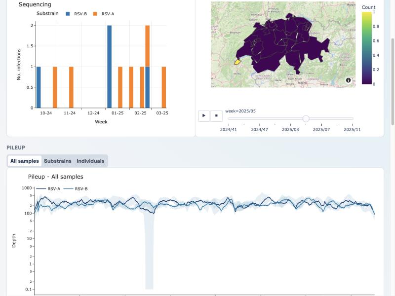

# ReVSeq Visuals

**Turn viral sequencing data into an interactive surveillance dashboard.**

[](LICENSE)
[](https://charlynebuerki.github.io/ReVSeq-dashboard/)
[](https://revseq.charlynebuerki.com/home/)

ReVSeq Visuals (*Rapid, Modular Environment for Viral Sequence Visualization*) builds a web dashboard from the outputs of a viral sequencing study: aligned reads, consensus genomes and sample metadata. It is made for multi-pathogen surveillance projects that want to share up-to-date results with collaborators, clinicians or public-health partners without each of them running bioinformatics tools.



**See it in action:** the [Swiss respiratory virus dashboard](https://revseq.charlynebuerki.com/home/) (649 genomes of 13 viruses, 2023–2025) · **Build your own:** the [step-by-step tutorial](https://charlynebuerki.github.io/ReVSeq-dashboard/), from BAM files to a hosted dashboard, on a small synthetic dataset.

## Features

- **Home page:** weekly sequencing and PCR detections of all viruses, with sequencing/PCR agreement on hover.
- **One page per virus**, each built from modules you switch on or off:
  - *time series and map* by week and region, for any region map (GeoJSON);
  - *genome quality:* sequencing depth along the annotated genome, for all samples, per subtype or per sample, to spot poorly covered regions; segmented viruses supported;
  - *phylogeny:* interactive Nextstrain/Auspice trees placing your samples among public genomes (official Nextclade datasets, or your own built from GenBank).
- **Co-infection page:** which viruses occur together in a sample, and the sequencing depth of each.
- **Data curation pipelines** (Snakemake/Python) that produce every input from BAM files, consensus genomes and metadata.
- **Configuration in one Python file:** viruses, modules, colours, map and text; no code changes needed.

## Quick start

With Docker, from a clone of this repository:

```bash
docker compose up --build
```

Then open <http://localhost:8000/home/>. The repository ships without data; the [tutorial](https://charlynebuerki.github.io/ReVSeq-dashboard/) generates a complete example dataset and walks through every step. It also runs in GitHub Codespaces, with nothing to install.

## Repository layout

| Path | Content |
|---|---|
| `dashboard/` | Django app: pages, plot modules, configuration (`config.py`) |
| `data_curation/Extract-pileup/` | BAM → sequencing depth and consensus genomes |
| `data_curation/Nextstrain-pipelines/` | consensus genomes + metadata → trees and dashboard metadata (Snakemake) |
| `tutorial/` | the tutorial notebooks, toy-data simulator and example configuration |

## Branches

| Branch | Content |
|---|---|
| `main` | the generic code, without data |
| `swiss-dashboard-implementation` | `main` plus the Swiss ReVSeq data (the deployed dashboard) |
| `tutorial` | kept identical to `main` |

Changes flow from `main` to the Swiss branch, never back: to update the Swiss dashboard, open a pull request with **base `swiss-dashboard-implementation` ← compare `main`**.

## Configuration (`dashboard/config.py`)

The main dashboard behavior is controlled in `dashboard/config.py`, which holds the defaults (the Swiss ReVSeq setup).
To use your own settings without editing it, write them in a separate Python file and point `REVSEQ_CONFIG` to it
(see `tutorial/toy_dashboard_config.py`). Settings you leave out keep their defaults; `STRAIN_ALIASES` and
`LOCATION_ALIASES` are added to the defaults.

### Global settings

- `DEFAULT_MODULES`
  - Default module toggles on strain pages:
    - `barplot_pcr`
    - `barplot_sequencing`
    - `map`
    - `pileup`
    - `tree`
- `DEFAULT_PILEUP_LEVELS`
  - Enabled pileup display modes (for example `all`, `substrain`, `individual`)
- `DEFAULT_PILEUP_MAX_INDIVIDUAL_TRACES`
  - Max number of traces rendered in individual pileup mode
- `MIXED_PAGE_ENABLED`
  - Enables/disables the mixed (co-infection) page

### Strain settings (`STRAIN_CONFIG`)

Each strain entry (for example `Influenza_A`, `RSV`, `SARS-CoV-2`) can define:

- `label`
  - UI display name
- `data_name`
  - Canonical strain name used for metadata harmonization
- `modules`
  - Per-strain module overrides
- `pileup_data_prefix`
  - Prefix used to load pileup JSONs from `dashboard/static/data/pileup`
- `pileup_segments`
  - Segment definitions for segmented viruses
- `pileup_default_segment`
  - Default selected segment in segmented pileup views
- `trees`
  - Auspice datasets to embed on the strain page (`title`, `dataset`)

### Supporting mappings

- `STRAIN_ORDER`
  - Controls strain ordering in UI/navigation
- `COLOR_BY_STRAIN`
  - Plot color mapping by canonical strain
- `SITE_TITLE`, `REGION_NAME`
  - Page header text
- `SITE_DESCRIPTION`
  - Summary shown by search engines (`<meta name="description">`); by default built from `REGION_NAME`
- `ABOUT_FILE`
  - Optional HTML fragment shown as an About page at `/about/` (default `dashboard/content/about.html`); without the file there is no About page
- `STRAIN_ALIASES`
  - Extra spellings of virus names in the metadata -> canonical strain
- `MAP_CONFIG`
  - `geojson`: region map; `id_property`: feature property holding the region codes used in the metadata `location` column; `name_property`: label shown on hover; `style`: optional tile basemap behind the regions (e.g. `"open-street-map"`, then also `center` and `zoom`); by default only the regions are drawn, with no external tile server
- `LOCATION_ALIASES`
  - Extra spellings of locations -> region code (codes present in the GeoJSON need no entry). Unmappable locations are kept in the time series but left off the map.

## Runtime Configuration

Main environment variables:

- `NEXTSTRAIN_BASE_URL`
  - local example: `http://127.0.0.1:4001`
  - reverse-proxy deployment example: `/nextstrain`
- `DJANGO_DEBUG` (`1` for local dev, `0` for deployment)
- `DJANGO_ALLOWED_HOSTS` (comma-separated hostnames)
- `DJANGO_SECRET_KEY` (required when `DJANGO_DEBUG=0`)
- `REVSEQ_CONFIG` (optional path to your settings file, see Configuration)

## Run Locally (No Docker)

Terminal 1 (Auspice). `npm ci` installs the tree viewer once, at the versions pinned in `package-lock.json`:

```bash
npm ci
```

```bash
HOST=0.0.0.0 PORT=4001 npx auspice view --datasetDir dashboard/static/auspice
```

Terminal 2 (Django):

```bash
export NEXTSTRAIN_BASE_URL=http://127.0.0.1:4001
python manage.py runserver
```

Open:

- `http://127.0.0.1:8000/home/`

## Run Locally (Docker Compose)

```bash
docker compose up --build
```

Open:

- Dashboard: `http://localhost:8000/home/`
- Auspice: `http://localhost:4000/`

## Deploy with Docker Images

### 1. Build and push versioned images

Build for the server's processor: run `uname -m` on the server and use `linux/arm64` for `aarch64`, `linux/amd64` for `x86_64`.

```bash
export REVSEQ_TAG=2026.03.05-1 DOCKERHUB_USER=<dockerhub_user> PLATFORM=linux/arm64

docker buildx build --platform $PLATFORM -f Dockerfile -t $DOCKERHUB_USER/revseq-dashboard:$REVSEQ_TAG --push .
docker buildx build --platform $PLATFORM -f Dockerfile_nextstrain -t $DOCKERHUB_USER/revseq-nextstrain:$REVSEQ_TAG --push .
```

If a build or pull stops with `no space left on device`, remove unused images with `docker image prune -a -f` and `docker builder prune -f`.

### 2. Set deploy environment on host

In the same directory as `docker-compose.deploy.yml`, create `.env`:

```env
REVSEQ_TAG=2026.03.05-1
DJANGO_SECRET_KEY=<strong_random_secret>
```

Ensure `docker-compose.deploy.yml` references:

- `${REVSEQ_TAG}` in image tags
- `${DJANGO_SECRET_KEY}` for dashboard environment

### 3. Pull and recreate containers

```bash
docker compose -f docker-compose.deploy.yml pull
docker compose -f docker-compose.deploy.yml up -d --force-recreate
```

### 4. Verify deployment

```bash
docker compose -f docker-compose.deploy.yml ps
docker logs revseq-dashboard --tail 80
docker logs revseq-nextstrain --tail 80
```

Optional local checks on host:

```bash
curl -I http://127.0.0.1:8000/home/
curl -I http://127.0.0.1:4000
```

If deployed behind a reverse proxy, route:

- `/` to Django (`:8000`)
- `/nextstrain/` to Auspice (`:4000`)
- `/dist/` and `/charon/` to Auspice (`:4000`)

## License and citation

ReVSeq Visuals is released under the [MIT License](LICENSE). If you use it, please cite the ReVSeq Visuals paper (Bürki, Neacșu, du Plessis and Stadler; citation details will be added on publication).
